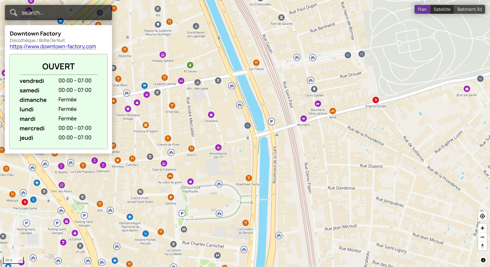

# Simplestreetmap

Another open source frontend map based on OSM data. A demo is available at [https://maps.ppsfleet.navy](https://maps.ppsfleet.navy)



What it does:

- search places and addresses, and reverse geocoding when you click on the map
- POI panel with details and opening hours
- a few layers: bicycle, satellite, 3D buildings
- pin places and share them: the map position and pinned places are kept in the URL

## Installation

The map layer lives in the [`esquisse`](https://github.com/tjiho/esquisse) submodule, so clone with it:

```
git clone --recurse-submodules https://github.com/tjiho/simplestreetmap.git
# or, if already cloned:
git submodule update --init --recursive
```

Edit `config.js` with your own search / reverse / tile servers and default view:

- `DEFAULT_CENTER` / `DEFAULT_ZOOM` — initial view when no `?map=` in the URL.
- `BASE_MAP_URL` — base map style.
- `POI_TILES_URL`, `BICYCLE_TILES_URL`, `BICYCLE_BASE_STYLE_URL`, `SATELLITE_TILES_URL`, `BATIMENT3D_TILES_URL` — per-layer sources.
- `BASE_SEARCH_URL`, `BASE_REVERSE_URL`, `BASE_OVERPASS_URL` — search / reverse / overpass endpoints.

Edit `index.html` to load maplibre (5.5.0) and pmtiles (4.3.0) from your server or some CDN. By default they come from `static.ppsfleet.navy`.

That's all, put it behind the server of your choice. For dev, I use PHP with `php -S localhost:<port>`.

## Install a search and reverse server

I use ADDOK: https://addok.readthedocs.io/en/latest/, it's quite easy to install and works very well with french addresses.

There are others, like [Photon](https://github.com/komoot/photon) or [Nominatim](https://nominatim.org/), but the results format is different so you'll have to adapt `src/api/search.js`.

## Serving tiles

Tiles are [PMTiles](https://docs.protomaps.com/pmtiles/) archives: just one static file, no tile server needed. Put it on any HTTP server that supports range requests (nginx, apache, an S3 bucket…) and point `config.js` to it with a `pmtiles://https://…` url.

To generate them from OSM data, have a look at [Planetiler](https://github.com/onthegomap/planetiler) or [Protomaps](https://docs.protomaps.com/). You can also extract a region from an existing archive with `pmtiles extract`.

You can use ppsfleet tiles for testing, but only for testing.

## Overpass

POI details are fetched from an Overpass API. The default one is `overpass.kumi.systems`, it's a public instance, so be nice with it, or host your own: https://wiki.openstreetmap.org/wiki/Overpass_API/Installation

## Data

- Map data © [OpenStreetMap contributors](https://www.openstreetmap.org/copyright), under ODbL.
- Satellite imagery and 3D buildings from [IGN / Géoplateforme](https://geoservices.ign.fr/).

## Dev

It does not need compilation.

To check the code: `npx standard --fix`

## License

GPL-3.0, see [LICENSE](./LICENSE).
